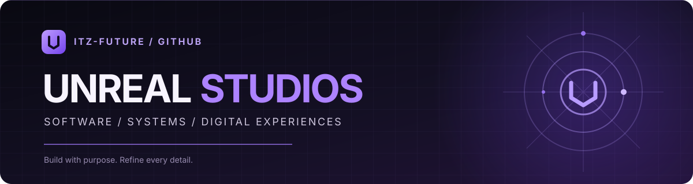
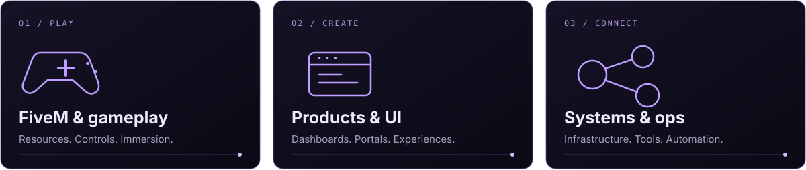

 

  

<strong>THE CREATOR BEHIND UNREAL STUDIOS</strong> &nbsp; ◇ &nbsp; DESIGNING WHAT'S NEXT

 

### <code>01</code> &nbsp; / &nbsp; THE PERSON BEHIND THE PIXELS

I build **Unreal Studios** — a creative development brand where thoughtful engineering meets exceptionally polished design.

From **FiveM resources and game tooling** to **web platforms, customer experiences, Minecraft projects, and self-hosted systems**, I like building things that don't just work. They feel *right*.

My philosophy is simple: **make it useful, make it beautiful, and keep pushing the details.**

 

### <code>02</code> &nbsp; / &nbsp; THE CREATIVE GRID

<table>
<tr>
<td width="33%" valign="top"><strong>GAMEPLAY ENGINEERING</strong> FiveM resources, ControlX, vehicle systems, custom menus and quality-of-life tools.</td>
<td width="33%" valign="top"><strong>PRODUCT EXPERIENCES</strong> Modern websites, portals, dashboards, analytics, support platforms and design systems.</td>
<td width="34%" valign="top"><strong>CONNECTED SYSTEMS</strong> Linux infrastructure, virtualization, deployments, automation and experimental AI interfaces.</td>
</tr>
</table>

 

### <code>03</code> &nbsp; / &nbsp; BUILT IN THE UNREAL UNIVERSE

| Project / domain | What it is |
| :-- | :-- |
| **[Unreal Studios](https://unrealstudios.ca)** | The home of our development work, releases, store and customer platform. |
| **[Unreal ControlX](https://unrealstudios.ca/products/fivem)** | Standalone FiveM emergency vehicle controls, sirens and lighting tools. |
| **[FiveM Resources](https://unrealstudios.ca/products/fivem)** | Vehicle HUD, Extra Menu, Music Zones, Trailer Support, Vehicle Spawner and more. |
| **[Minecraft Projects](https://unrealstudios.ca/products)** | Community tools, gameplay utilities and other experiments. |
| **Unreal Studios Infrastructure** | Internal platforms, automation, support systems and operational tooling. |

Not everything I build is public source code. Some projects are private, commercial, or released through Unreal Studios.

 

### <code>04</code> &nbsp; / &nbsp; TOOLS OF THE TRADE

 

### <code>05</code> &nbsp; / &nbsp; MISSION CONTROL

> **Design with intention.** &nbsp; **Engineer for reliability.** &nbsp; **Refine every detail.**

 

### READY TO BUILD SOMETHING GREAT?

**[VISIT UNREAL STUDIOS](https://unrealstudios.ca)** &nbsp; / &nbsp; **[EXPLORE PRODUCTS](https://unrealstudios.ca/products)** &nbsp; / &nbsp; **[GET SUPPORT](https://unrealstudios.ca/support)**

 

UNREAL STUDIOS &nbsp; ◇ &nbsp; CRAFTED BY <a href="https://github.com/Itz-Future">ITZ-FUTURE</a> Independent development. Unreasonable attention to detail.

